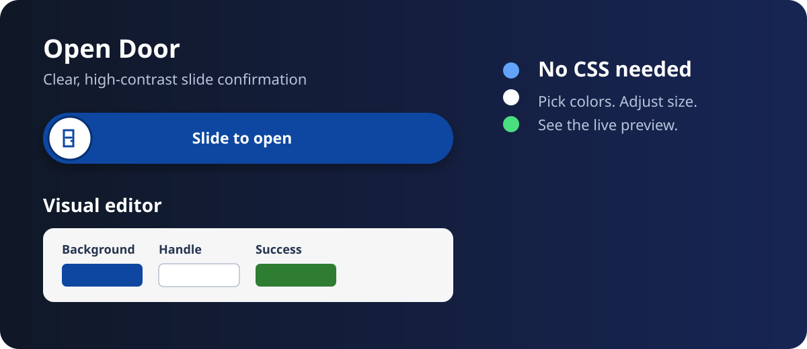

# Slide Confirm Plus

A Home Assistant custom card for actions that should not happen from one accidental tap. Drag the high-contrast handle all the way across to call a service.

Slide Confirm Plus adds a visual dashboard editor and practical appearance controls to the original Slide to Confirm card: color controls for the track, handle, text, and success state; plus height, handle size, and corner-radius inputs. Changes are reflected in Home Assistant's live card preview while editing.



## Why this fork

The original card is intentionally simple and dependable. This fork keeps the same slide-to-confirm interaction while making it easier to match a dashboard without CSS or card-mod. The default handle is larger, white, outlined, and set against a strong blue track so it is easy to see at a glance.

## Install

### HACS

1. In HACS, open **Frontend** and select **Custom repositories**.
2. Add this repository with category **Dashboard**.
3. Install **Slide Confirm Plus** and reload Home Assistant.
4. Add the card to a dashboard. The visual editor is available when you choose the card in the dashboard UI.

### Manual

Copy `dist/slide-confirm.js` to `/config/www/slide-confirm-plus/slide-confirm.js`, then add it as a Lovelace JavaScript module resource:

```yaml
url: /local/slide-confirm-plus/slide-confirm.js?v=2.0.0
type: module
```

**Register only one implementation.** This fork and the official card share
`custom:slide-confirm-card` and internal custom-element names. Remove the official
`/local/community/slide-confirm/slide-confirm.js` resource (including query-string
variants) before adding the fork resource. Do not register both; whichever loads
first can silently win. Keep the fork in its own directory, never copy it over the
official HACS-managed file: an official update would overwrite it. Change the
`?v=` value after updates, then reload every dashboard browser/app.

## v2.0.0

Based on the official [`v2.0.0`](https://github.com/itsbrianburton/slide-confirm/releases/tag/v2.0.0)
rewrite (commit `40e81e44297a806a5fca211013bd609d011f957d`): Lit 3, Vite,
HA-native actions, keyboard/RTL support, state-aware disabling, native visual
editor, and unit/real-browser tests. Plus retains its `appearance` block and old
config without requiring edits. See [upstream options](docs/upstream-v2-readme.md)
and [migration details](docs/migration-v1-to-v2.md).

- Snake-case text/icon fields are preferred; they win over camelCase if both exist.
- `reset_delay` wins over `confirmation_duration`. The legacy duration still means
  milliseconds clamped to 500–10,000 (default 1,500). Native `reset_delay: 0`
  waits for an entity change, with upstream's safety timeout.
- `appearance` retains its colors, opacity, flat/3D finish, sizes and left/center
  position. Omitting `handle_position` within an existing appearance block means
  **center**, matching the old runtime (the old editor explicitly wrote `left`).
  Without `appearance`, upstream theme/style defaults apply.
- Per-slider `style` wins over matching `appearance` colors/sizes. Card-level
  `style` supplies inherited defaults; an explicit appearance block overrides them.
- Old `call-service` actions become `perform-action` and are delegated through
  HA's `hass-action`, preserving target/data and confirmation dialogs. The card
  no longer calls services directly. A successful gesture means **command sent**,
  not proof that a physical door changed state.

## Visual editor

The HA-native editor supports adding, removing and reordering sliders and places styling in expandable sections:

- card and slider title
- service and a standard Home Assistant entity dropdown
- instruction and completion text
- icon names
- background, handle, text, success-background, and success-handle hex color inputs
- track opacity, including a transparent resting track, and a separate green success track
- a simple selector for a glossy 3D ball or flat round handle
- slider height, handle size, and corner radius

The Upgrade button migrates text/icon keys, actions and duration without deleting Plus appearance settings. Icon fields accept static MDI names or trusted JavaScript templates.

## Example

```yaml
type: custom:slide-confirm-card
header: Front entrance
sliders:
  - name: Open Door
    icon: mdi:door
    textUnconfirmed: Slide to open
    textConfirmed: Door command sent
    iconUnconfirmed: mdi:door-closed
    iconConfirmed: mdi:door-open
    confirmation_duration: 1800
    appearance:
      background_color: "#0d47a1"
      background_opacity: 0.18
      handle_color: "#ffffff"
      handle_style: 3d
      handle_position: left
      text_color: "#ffffff"
      confirmed_background_color: "#2e7d32"
      confirmed_background_opacity: 0.96
      confirmed_handle_color: "#ffffff"
      height: 64
      handle_size: 54
      border_radius: 32
    confirm_action:
      action: call-service
      service: switch.toggle
      target:
        entity_id: switch.entree_haustur_299
```

## Configuration

Each slider retains the original action fields:

| Field                   | Required | Description                                                                                              |
| ----------------------- | -------- | -------------------------------------------------------------------------------------------------------- |
| `name`                  | no       | Text above the slider.                                                                                   |
| `icon`                  | no       | MDI icon beside the title.                                                                               |
| `textUnconfirmed`       | no       | Text shown before confirming.                                                                            |
| `textConfirmed`         | no       | Text shown after confirming.                                                                             |
| `iconUnconfirmed`       | no       | MDI icon inside the handle before confirming.                                                            |
| `iconConfirmed`         | no       | MDI icon inside the handle after confirming.                                                             |
| `confirmation_duration` | no       | Success display time in milliseconds; 500–10,000, default 1,500.                                         |
| `confirm_action`        | yes      | A Home Assistant dashboard action (`perform-action`, `toggle`, etc.); legacy `call-service` is accepted. |
| `appearance`            | no       | Appearance options below.                                                                                |

### `appearance`

All color values are hex colors. The visual editor writes these values for you.

| Field                          | Default         | Description                                                                        |
| ------------------------------ | --------------- | ---------------------------------------------------------------------------------- |
| `background_color`             | `#1976d2`       | Normal slider-track color.                                                         |
| `background_opacity`           | `0.92`          | Normal track opacity; use `0` for transparent.                                     |
| `handle_color`                 | `#ffffff`       | Normal handle color.                                                               |
| `handle_style`                 | `3d`            | `3d` gives the round handle a glossy ball finish; `flat` uses a flat circle.       |
| `handle_position`              | `center`        | Initial handle position: `left` (inset by the same gap as top/bottom) or `center`. |
| `text_color`                   | `#ffffff`       | Instruction and completion text color.                                             |
| `confirmed_background_color`   | `#2e7d32`       | Track color after a successful slide.                                              |
| `confirmed_background_opacity` | `0.96`          | Success-track opacity.                                                             |
| `confirmed_handle_color`       | `#ffffff`       | Handle color after a successful slide.                                             |
| `height`                       | `56`            | Slider height in pixels; 40–120.                                                   |
| `handle_size`                  | `48`            | Handle diameter in pixels; 32–100. It is kept inside the slider height.            |
| `border_radius`                | half the height | Corner radius in pixels; 0–60.                                                     |

### Dynamic icons

The old checked-in fork passed `[[[ ... ]]]` strings literally to `ha-icon`; it did
not evaluate them. This version adds support for trusted JS bodies in `icon`,
`iconUnconfirmed` / `icon_unconfirmed` and `iconConfirmed` / `icon_confirmed`:

```yaml
iconUnconfirmed: >-
  [[[ return states['switch.entree_haustur_299']?.state === 'on'
      ? 'mdi:door-open' : 'mdi:door-closed'; ]]]
```

Templates receive `states` and `entity` (the optional slider entity's state object),
not `hass` or a service client. They re-evaluate when HA supplies new state. Missing
entities, syntax/runtime errors, empty or non-string results fall back to static
icons. **This is arbitrary JavaScript, not a sandbox. Only use trusted dashboard
config.** Browser CSP must permit `new Function`; restrictive CSP uses fallback
icons. Text and action fields are not evaluated as JavaScript.

## Safety and behavior

- An HA action is emitted only after an active gesture reaches the end (or deliberate keyboard progress reaches 100%). State/config updates, interrupted gestures, disconnects, and disabling a moving slider do not emit actions.
- Pointer events are used for mouse and touch, avoiding duplicate touch/pointer handling.
- The confirmation threshold has a small tolerance, so a successful full slide is reliable.
- This card does not determine whether an action is safe. For locks, doors, or other physical controls, enforce authorization and safety checks in Home Assistant too.

## Credits and license

Slide Confirm Plus is a derivative of [Slide to Confirm](https://github.com/itsbrianburton/slide-confirm) by Brian Burton. The original project supplied the card concept, structure, and slide-confirm interaction. This repository adds the visual editor, appearance model, accessibility labels, stronger default contrast, and input handling improvements.

The upstream project is licensed under the MIT License. Its copyright notice is retained in [LICENSE](LICENSE), as required by that license.

## Development

```bash
npm ci
npx playwright install --with-deps chromium
npm run check
```

Requires Node >=22.12. Build output: `dist/slide-confirm.js` plus source map. In restricted environments set `PLAYWRIGHT_BROWSERS_PATH` to a writable cache directory. Tests use mocked HA state only; they never connect to HA.
